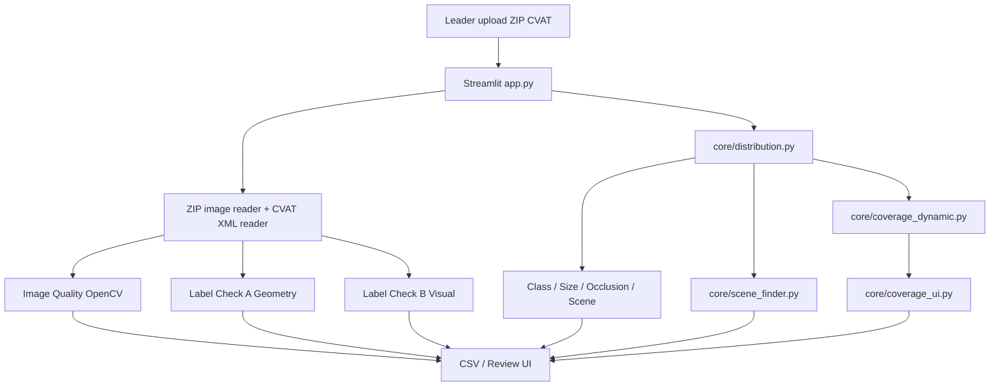

# GIẢI PHÁP KỸ THUẬT — N2-05B DASHBOARD CVAT

**Hệ thống:** CVAT Quality Control Dashboard (Streamlit, Python, Pandas, Plotly, OpenCV).
**Mục tiêu:** Hỗ trợ Leader thống kê phân bố class/thuộc tính, sàng lọc chất lượng ảnh và box, đánh giá Coverage động **không có Ground Truth**.

## 1. Kiến trúc thực tế



### Cấu trúc code hiện có

| File                         | Trách nhiệm                                                                            |
| ---------------------------- | ---------------------------------------------------------------------------------------- |
| `app.py`                   | Entry point Streamlit, upload ZIP, cache phiên, phân tích ảnh/label, 7 tabs, export. |
| `ui_theme.py`              | CSS/theme giao diện.                                                                    |
| `core/distribution.py`     | Parse`annotations.xml`, class, size, occlusion, scene tags, attributes.                |
| `core/coverage_dynamic.py` | Universe box hợp lệ, slice support, target evaluation, recommendations.                |
| `core/coverage_ui.py`      | UI cấu hình slice/JSON, chỉnh target, biểu đồ và export.                          |
| `core/scene_finder.py`     | Lọc ảnh theo weather/timeofday, tìm tên, preview và CSV.                            |
| `Docs/`                    | Công thức, chỉ số/ngưỡng và tài liệu dự án.                                   |
| `tests/`                   | Kiểm thử một số hành vi coverage và scene finder; chưa đầy đủ.                |

## 2. Công nghệ và triển khai

- Python 3.10+, Streamlit cho giao diện, Pandas cho bảng, Plotly cho biểu đồ.
- OpenCV (`cv2`) và NumPy cho đo chất lượng ảnh, crop/geometry; Pillow phục vụ preview.
- `zipfile` để đọc archive; XML parser trong `app.py`/`core/distribution.py` dùng `xml.etree.ElementTree`. **Chưa sử dụng `defusedxml` trong parser này**, nên cần tăng cường an toàn XML trước khi nhận dữ liệu không tin cậy ở môi trường public.
- `.streamlit/config.toml` cho theme, `Dockerfile` cho container, `.github/workflows/tests.yml` cho CI.
- Chưa có database, authentication, lịch sử sửa nhãn hay CVAT API write-back.

## 3. Input, schema và pipeline

**Input:** một ZIP có ảnh JPG/JPEG/PNG/BMP/WEBP và/hoặc `annotations.xml` theo CVAT for images. Image Quality có thể chạy với ZIP chỉ có ảnh; các phân tích nhãn/scene cần XML. Scene Finder có thể liệt kê bản ghi XML khi ZIP không có ảnh, nhưng không thể preview.

**Schema trong `core/distribution.py`:**

```text
images: image_id, image_name, weather, timeofday
boxes:  image_id, image_name, box_id, label, occluded,
        valid_geometry, area_pct, attributes
```

`valid_geometry` của parser phân bố kiểm tra `x2>x1`, `y2>y1`, W,H>0; chưa tự kiểm tra toàn bộ out-of-bounds. Bảng `images` và `boxes` được ghép qua `image_id`. **Chưa có `dataset_id` trong schema**; không nên gộp nhiều ZIP chỉ bằng ID.

**Luồng dữ liệu:** ZIP → đọc ảnh/XML → tính IQ/A/B và bảng phân bố → ghép box với scene metadata → tính coverage → lọc ảnh/recommendations → render/export.

## 4. Module Distribution & Attributes

`class_distribution()` đếm số box, số tên ảnh duy nhất chứa class, `share_pct`. `imbalance_warnings()` lọc theo số box tối thiểu và share min/max do Leader chỉnh. Kích thước box đo bằng `area_pct` và nhóm `<0.1%`, `0.1–1%`, `>1%`. Occlusion thống kê từ thuộc tính box. Weather/timeofday được đọc từ tag `scene_info` hoặc tag riêng trong XML; `missing` được điền khi không có giá trị. `attribute_distribution()` đọc các tên attribute tùy chỉnh từ box.

**Diễn giải:** phân bố box không đồng nghĩa phân bố ảnh; mất cân bằng không đồng nghĩa annotation lỗi. Một ảnh có nhiều class nên tổng image coverage có thể vượt 100%.

## 5. Image Quality và Label Check A/B

### Image Quality

Chuyển ảnh sang grayscale và tính Laplacian variance (blur), mean brightness, standard deviation contrast, noise MAD vùng phẳng, tỷ lệ pixel gần đen/trắng, kích thước và dung lượng ảnh. Các rule phát `BLUR`, `DARK`, `OVEREXPOSED`, `LOW_CONTRAST`, `LOW_RESOLUTION`, `POSSIBLE_HIGH_NOISE`; điểm sàng lọc bắt đầu từ 100 rồi trừ penalty. Có histogram, scatter và issue frequency để Leader chọn ảnh review.

### Label Check A

Đọc tọa độ box, tính diện tích tương đối, aspect ratio và IoU; cảnh báo `INVALID_BOX`, `OUT_OF_BOUNDS`, `SMALL_BOX`, `LARGE_BOX`, `ASPECT_RATIO_OUTLIER`, `POSSIBLE_DUPLICATE`. Các ngưỡng chỉnh từ sidebar.

### Label Check B

Với box có ảnh phù hợp, đo edge density, texture/Laplacian, foreground contrast và boundary support. Kết hợp tín hiệu để gợi ý `POSSIBLE_EMPTY_BOX` và ưu tiên HIGH/MEDIUM/LOW. Không có GT nên không xác nhận class đúng, không tìm được missing objects chỉ từ các phép đo này.

**Tham chiếu:** `Docs/Algorithms_Formulas.md` và `Docs/Metrics_Thresholds.md` mô tả công thức chi tiết; lưu ý tài liệu gốc được viết cho bản merged ban đầu.

## 6. Coverage & Slice động

**Chiều phân tích:** `class`, `weather`, `timeofday`, `occluded`. Không hard-code tên class. `build_universe()` giữ box có `valid_geometry=True` và ghép metadata ảnh. `count_support()` lọc đồng thời các điều kiện (AND): `images` đếm `image_id` duy nhất, `objects` đếm box.

```text
support = số ảnh hoặc box hợp lệ khớp filters
 gap = max(0, target - support)
 attainment_pct = 100 * support / target
 weighted_gap = (gap / target) * weight
 status = "Đạt" nếu gap == 0, ngược lại "Thiếu"
 weighted_coverage = 100 * sum(weight của slice đạt) / sum(weight tất cả slice)
```

`target` là số nguyên dương; `weight` là số thực dương. Có ba cách cấu hình: thêm một slice; tạo tổ hợp tự động (chỉ tổ hợp quan sát hoặc tích Descartes, tối đa 250); nhập JSON. Leader chỉnh bảng target và tải JSON/CSV.

**Ví dụ:**

```json
[{"name":"bus-night-rain","filters":{"class":"bus","timeofday":"night","weather":"rain"},"unit":"images","target":100,"weight":2}]
```

Nếu support=35 → gap=65, attainment=35%, weighted_gap=1.3. `recommendations()` ưu tiên slice gap>0; nếu metadata chưa rõ thì gợi ý bổ sung metadata trước.

**Giới hạn:** target chưa hỗ trợ tỷ lệ %, class vắng hoàn toàn không tự sinh từ dataset, các slice có thể giao nhau nên không cộng gap, `metadata_unresolved` là tổng lượt theo trường (có thể đếm trùng ảnh). `confidence=Quan sát/Tạm thời` là nhãn mô tả metadata, không phải xác suất.

## 7. Scene Finder — truy vết ảnh metadata

Bộ lọc `weather` và `timeofday` hoạt động đồng thời; không chọn giá trị nghĩa là không giới hạn chiều đó. Hỗ trợ tìm chuỗi trong tên ảnh, đếm ảnh khớp, bảng `image_id,image_name,weather,timeofday`, phân trang và CSV. Nếu ZIP có ảnh gốc, tìm đường dẫn đầy đủ/hậu tố/basename duy nhất để preview. Không tự sửa XML/CVAT.

**Use case:** Chọn `weather=unknown` AND `timeofday=unknown` → danh sách ảnh cần xem → Leader xác minh bằng mắt → annotator sửa trong CVAT → export lại và so sánh.

## 8. Giao diện và báo cáo

Bảy tab trong `app.py`: **Tổng quan; Phân bố & thuộc tính; Image Quality; Label Check A+B; Review ảnh; Xuất báo cáo; Coverage & Slice**. Giao diện dùng theme tùy chỉnh. Export gồm CSV chất lượng ảnh, label, class/attribute/box, danh sách scene, coverage/recommendations và target JSON.

## 9. Bảo mật, hiệu năng, tính đúng đắn

- Giới hạn kích thước ảnh theo code và kiểm tra archive; không thực thi file trong ZIP.
- Đọc ZIP bằng bộ nhớ có thể tốn RAM với dataset lớn; cần benchmark và tối ưu khi triển khai public.
- Nên dùng parser XML chống entity expansion và kiểm tra giới hạn số file, tỷ lệ nén, đường dẫn archive.
- Cần chuẩn hóa schema và ID trước khi hỗ trợ nhiều ZIP/annotator; nên thêm provenance và timestamp.
- Đặt metric denominator rõ ràng; không cộng gap slice giao nhau; không so sánh số `images` với `objects` trên cùng thang.
- Test thêm: XML thiếu metadata, box invalid/out-of-bounds, duplicate image IDs, ZIP chỉ XML, ZIP chỉ ảnh, support=0, class không quan sát, unknown/missing.

## 10. Hướng phát triển

1. Tách parser, quality, coverage và UI khỏi `app.py` để dễ unit test.
2. Cho target theo tỷ lệ %, mục tiêu theo từng class và file cấu hình ngoài.
3. Bổ sung multi-ZIP và `dataset_id:image_id` để Leader tổng hợp nhiều annotator.
4. Review Queue có xác nhận đúng/sai và xuất feedback.
5. Chuẩn hóa missing/unknown và thêm bảng kiểm chứng baseline/pilot.
6. Triển khai Docker, CI và kiểm thử end-to-end trên ZIP CVAT thật.
